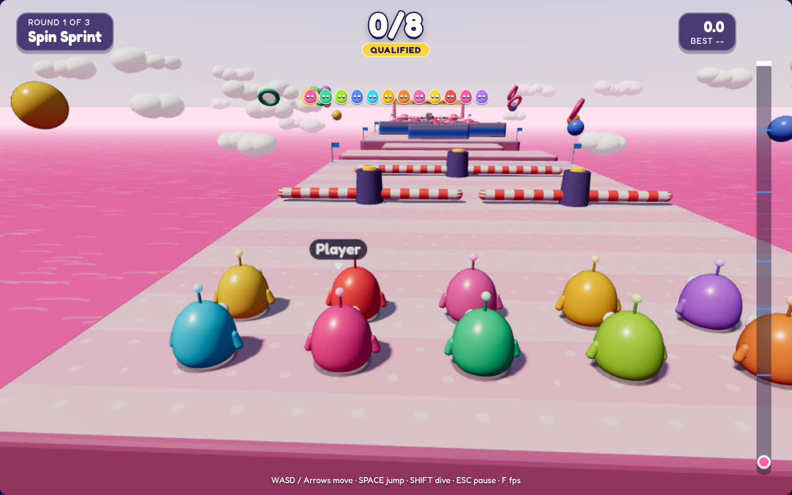
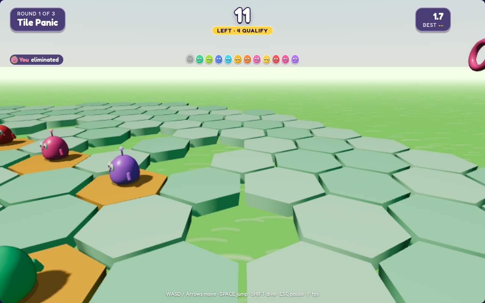
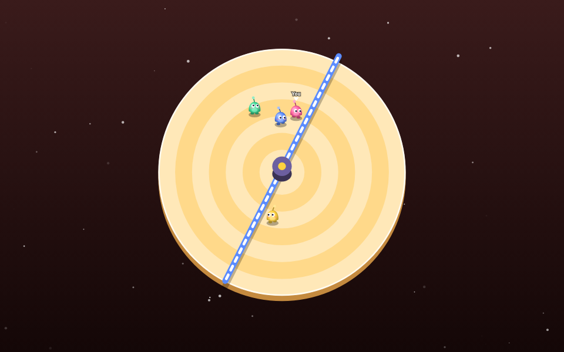
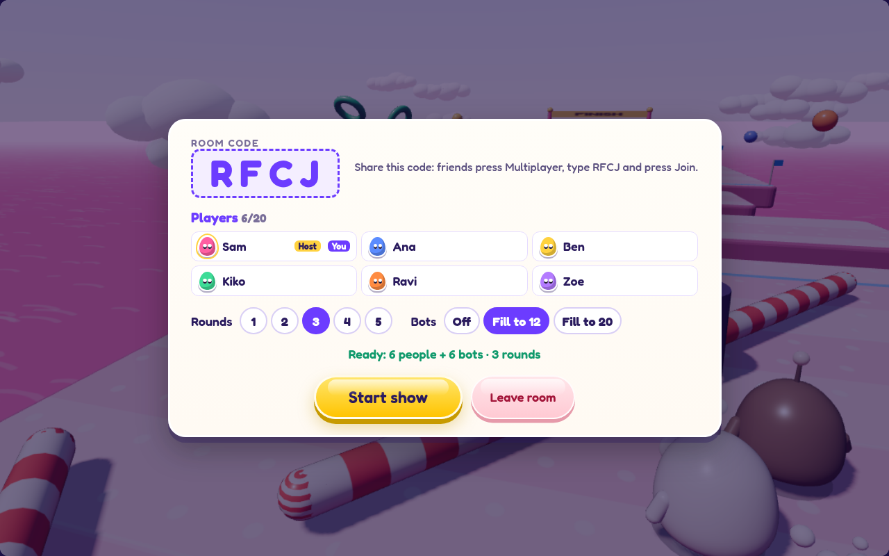

# Wobble Rush

[](https://github.com/maulikhorasiya14/wobble-rush/actions/workflows/tests.yml)

An original 3D obstacle-course party game that runs in your browser. Play alone
against 11 computer players, or **with up to 20 friends** in a multiplayer room joined
with a 4-letter code. Survive knockout rounds (races, crumbling-tile survival rounds
and a last-one-standing final) and try to win the crown.


| Spin Sprint (race) | Tile Panic (survival) | Spin Arena (final) |
|---|---|---|
|  |  |  |

| Multiplayer lobby |
|---|
|  |

**How it's built**

- **Python (Flask)** serves the game and owns the game data: level layouts, physics
  tuning, the show format, scoring and the personal-best save file.
- **JavaScript** runs the moment-to-moment simulation and the AI rivals, using the
  numbers the Python server provides, and draws the game in **3D with
  [three.js](https://threejs.org)** (with a classic 2D view as a fallback).
- **Multiplayer** runs over WebSockets (`flask-sock`): the Python server keeps the
  rooms and runs the show. Every player moves their own character in their own
  browser (so controls respond instantly) and reports it; the room host's browser
  runs the rest of each round (bots, obstacles, rules) in a background worker and
  streams 30 snapshots a second, which every browser plays back smoothly.

New to the game? Read **[GUIDE.md](GUIDE.md)**, or play the in-game tutorial.

## Requirements

- Python 3.10 or newer
- A modern browser (Chrome, Firefox, Edge or Safari)

## Setup and run

```bash
git clone https://github.com/maulikhorasiya14/wobble-rush.git
cd wobble-rush
python3 -m venv .venv
source .venv/bin/activate        # Windows: .venv\Scripts\activate
pip install -r requirements.txt
python run.py
```

The game opens at http://127.0.0.1:5000. Press `Ctrl+C` in the terminal to stop it.
Set `WOBBLE_NO_BROWSER=1` to stop `run.py` from opening a browser tab.

### Playing with friends

1. Press **Multiplayer**, type your name and press **Create room**. You get a
   4-letter room code and become the host.
2. Friends open the game on the same server, press **Multiplayer**, type the code
   and press **Join** (up to 20 players per room).
3. The host picks 1–5 rounds and whether to fill empty spots with bots, then presses
   **Start show**. Fewer players qualify each round until one takes the crown.

Everyone needs to reach the same server: run it on a computer your friends can
connect to, or put it behind a tunnel such as ngrok, or forward port 5000 on your
router.

Set `WOBBLE_HOST=127.0.0.1` to keep the game on your own computer only, and
`WOBBLE_PORT` to use a different port.

If a player's connection drops mid-game (a Wi-Fi blip), their browser reconnects by
itself and they carry on in the same round; the server holds their place for 20 s
(8 s for the host). The server doesn't restart itself when files change, because that
would drop everyone in a room; while editing the game, start it with
`WOBBLE_RELOAD=1 python run.py` to get automatic restarts.

## Features

- Pick a **3, 4 or 5-round** show; rounds are drawn at random from 18 rounds, each
  tagged with where it can appear (opener, middle, final)
- 7 themed worlds, each with its own 3D scenery: tropical islands, snowy peaks,
  candy land, high above the clouds, out at sea, a futuristic city and a neon arena
  (floors sit on floating islands or glowing frames; mountains, skylines and neon
  hills on the horizon)
- 12 long races (9,000–10,500 px, 10–12 sections each, from a library of 48 section
  types in `game/courses.py`; every race has its own signature sections, no section
  type appears in more than three races, and the finish stays hidden in the distance
  until you get close). Obstacles include rotating hammers, vanishing platforms, bumper
  carousels, giant bouncing balls, balance beams, mystery doors, hidden-path trust tiles,
  crumbling bridges, tilting platforms, rolling logs, cannon alleys and shifting gates,
  with door and tile layouts reshuffled every round (the same for everyone in
  multiplayer): Spin Sprint, Conveyor Canyon, Bounce Bay, Frosty Slopes, Hammer Hall,
  Drift Lifts, Gusty Gorge, Turntable Trail, Piston Pass, Neon Nexus, Sky Spires,
  Lagoon Leap
- 3 survival rounds: Tile Panic, Meteor Meadow, Blizzard Bluff
- 3 finals: Spin Arena, Cannon Clash, Pinball Pit
- 11 AI rivals with different skill levels
- **Multiplayer rooms**: up to 20 people join with a 4-letter code; the host picks
  1–5 rounds and can fill empty spots with bots (12 by default). Fewer players
  qualify each round until one wins the crown. Your own character responds
  instantly while everyone else moves smoothly; finished and knocked-out players
  keep watching (← → to switch), the host role moves on if the host leaves, and
  each player's stats and personal bests are saved to their own profile
- Jumping, diving, jump-dive combos, checkpoints, knockbacks and stuns
- Interactive tutorial with step-by-step tips, offered automatically on first play
- Personal bests saved locally: best score, furthest round, crowns, best times per level
  (each round's best is saved as soon as the round ends)
- Pick your name and colour
- Original cartoon sound effects and music, all synthesized in the browser (no audio
  files): footsteps that change with the surface (ice, snow, metal, belts), jumps,
  landings, dives, splashes, bonks and boings; little cartoon voices ("hup!", "oof!",
  "waaah!") with each character at its own pitch; whooshes, slams and chimes as
  spinners, hammers, bouncing balls, walls, vanishing platforms and logs pass close by;
  other players heard from where they are (panned and quieter with distance) in a
  small room reverb; a quiet ambience for each world (waves, wind, a city hum); a
  cheering crowd for the start, qualifying and the crown, a sad trombone when you're
  out; and four original music tracks (menu, race, survival,
  final) built from sections with randomized phrases so they don't loop audibly.
  Separate volume sliders for effects and music.
- Settings: graphics mode and quality, sound volume, mouse sensitivity, invert Y, FPS counter
- Round intro cards preview the course section by section; a **Rounds** gallery shows them all
- Live race position, section labels and confetti when you qualify or win
- 3D graphics: lit, shadowed candy courses, original animated characters (running,
  jumping, diving, landing squash, ragdoll tumbles when hit), particles and a smooth
  chase camera with fly-over round intros
- Smooth movement: fixed-step physics with interpolated drawing, jump buffering and
  "coyote time" (a brief grace period to jump after running off an edge)
- Automatic resolution scaling to hold a steady frame rate; **Graphics** button on the
  menu switches between 3D and the classic 2D view (also used automatically when the
  browser has no WebGL)

## Project structure

```
wobble-rush/
├── .github/workflows/       # Runs the tests on every push (GitHub Actions)
├── docs/screenshots/        # Images used in this README
├── run.py                   # Starts the local server
├── GUIDE.md                 # Player guide (controls, rounds, scoring, tips)
├── requirements.txt
├── data/                    # Local save file (save.json, git-ignored)
├── game/
│   ├── __init__.py          # Flask app factory
│   ├── levels.py            # Levels, physics, show format, palette
│   ├── courses.py           # The twelve race courses, built from sections
│   ├── rules.py             # Result validation, scoring, personal bests
│   ├── storage.py           # JSON save file load/save/reset
│   ├── routes.py            # Page + JSON API
│   ├── multiplayer.py       # Rooms, codes and the multiplayer show (WebSocket /ws)
│   ├── identity.py          # Host's save file vs. per-friend guest save files
│   ├── templates/index.html # Menus, HUD and screens
│   └── static/
│       ├── css/style.css
│       └── js/
│           ├── main.js      # Game flow, menus, HUD
│           ├── mp.js        # Multiplayer: lobby, rounds, watching
│           ├── netsync.js   # Snapshots and smooth playback of other players
│           ├── hostworker.js # Runs a multiplayer round for the host (background worker)
│           ├── world.js     # Physics, obstacles, round rules
│           ├── bots.js      # AI rivals
│           ├── render3d.js  # 3D renderer: scene, characters, animation, camera
│           ├── scenery.js   # 3D surroundings for each themed world
│           ├── render.js    # Classic 2D renderer (fallback) + progress bar
│           ├── input.js     # Keyboard input
│           ├── sfx.js       # Sound effects and mixing (Web Audio)
│           ├── music.js     # Background music: original tunes on a small sequencer
│           └── api.js       # Calls to the Python API
│       └── vendor/          # three.js (MIT) and the Fredoka font (OFL), bundled for offline play
└── tests/                   # pytest suite
```

## API

| Method | Path                    | Purpose                                         |
|--------|-------------------------|-------------------------------------------------|
| GET    | `/api/levels`           | All game data (levels, physics, show format)    |
| GET    | `/api/profile`          | Name, colour, stats and personal bests          |
| POST   | `/api/profile`          | Update `name` and/or `color`                    |
| POST   | `/api/profile/tutorial` | Mark tutorial done, record its time `{time}`   |
| POST   | `/api/profile/reset`    | Clear stats and personal bests                 |
| POST   | `/api/show`             | Start a random show `{rounds: 3/4/5}`, returns `show_id` and its rounds |
| POST   | `/api/round`            | Save a finished round's personal best right away `{show_id, index, time, qualified}` |
| POST   | `/api/results`          | Submit a finished show `{show_id, rounds: [...]}`, get score and new records |
| WS     | `/ws`                   | Multiplayer messages (see `game/multiplayer.py`) |

Requests from the computer running the server use `data/save.json`. Friends on the
network each get their own save file in `data/guests/` (picked by a cookie).

## Tests

```bash
pytest
```

They also run automatically on GitHub for every push and pull request. The tests cover level sanity (every gap can be crossed, spawns and checkpoints sit on
the floor), scoring and personal-best rules, save-file handling, the API, and
multiplayer rooms (codes, joining, the 20-player cap, host hand-over, a full show).

## Third-party assets

- [three.js](https://github.com/mrdoob/three.js) r170, MIT licence: `game/static/vendor/three/LICENSE`
- [Fredoka](https://github.com/hafontia/Fredoka-One) font, SIL Open Font License: `game/static/vendor/fonts/OFL-LICENSE.txt`

All characters, courses and artwork are original and generated in code.

## Changing the game

Most tuning lives in `game/levels.py`: physics numbers, level layouts, obstacles, how
many players qualify per round, and bot names. Restart the server after editing it.
