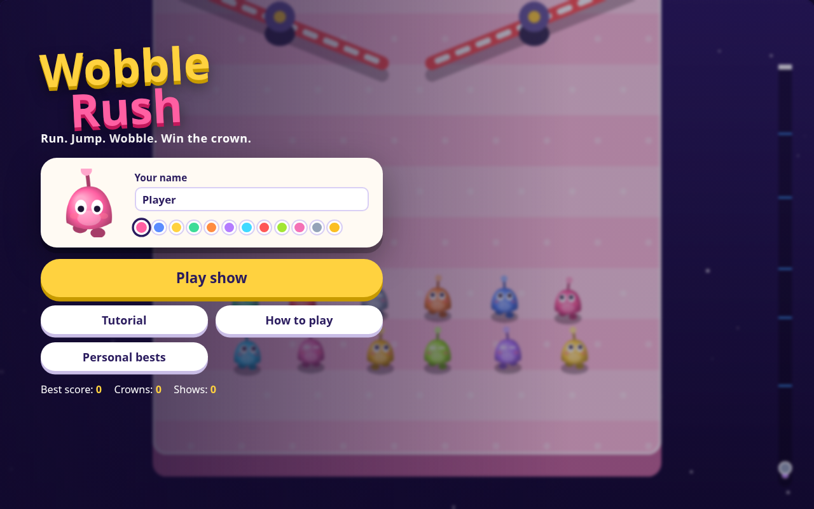

# Wobble Rush

[](https://github.com/maulikhorasiya14/wobble-rush/actions/workflows/tests.yml)

An original, single-player obstacle-course party game that runs locally in your browser.
Race 11 computer players through three knockout rounds (a race, a crumbling-tile
survival round and a spinning-beam final) and try to win the crown.



| Spin Sprint (race) | Tile Panic (survival) | Spin Arena (final) |
|---|---|---|
|  |  |  |

- **Python (Flask)** serves the game and owns the game data: level layouts, physics
  tuning, the show format, scoring and the personal-best save file.
- **JavaScript (HTML canvas)** runs the moment-to-moment simulation, the AI rivals and
  the drawing, using the numbers the Python server provides.

New to the game? Read **[GUIDE.md](GUIDE.md)**, or play the in-game tutorial.

## Requirements

- Python 3.10 or newer
- A modern browser (Chrome, Firefox, Edge or Safari)

## Setup and run

```bash
git clone https://github.com/maulikhorasiya14/wobble-rush.git
cd wobble-rush
python3 -m venv .venv
source .venv/bin/activate        # Windows: .venv\Scripts\activate
pip install -r requirements.txt
python run.py
```

The game opens at http://127.0.0.1:5000. Press `Ctrl+C` in the terminal to stop it.
Set `WOBBLE_NO_BROWSER=1` to stop `run.py` from opening a browser tab.

## Features

- 3-round show: **Spin Sprint** (race) → **Tile Panic** (survival) → **Spin Arena** (final)
- 11 AI rivals with different skill levels
- Jumping, diving, jump-dive combos, checkpoints, knockbacks and stuns
- Interactive tutorial with step-by-step tips, offered automatically on first play
- Personal bests saved locally: best score, furthest round, crowns, best times per level
- Pick your name and colour

## Project structure

```
wobble-rush/
├── .github/workflows/       # Runs the tests on every push (GitHub Actions)
├── docs/screenshots/        # Images used in this README
├── run.py                   # Starts the local server
├── GUIDE.md                 # Player guide (controls, rounds, scoring, tips)
├── requirements.txt
├── data/                    # Local save file (save.json, git-ignored)
├── game/
│   ├── __init__.py          # Flask app factory
│   ├── levels.py            # Levels, physics, show format, palette
│   ├── rules.py             # Result validation, scoring, personal bests
│   ├── storage.py           # JSON save file load/save/reset
│   ├── routes.py            # Page + JSON API
│   ├── templates/index.html # Menus, HUD and screens
│   └── static/
│       ├── css/style.css
│       └── js/
│           ├── main.js      # Game flow, menus, HUD
│           ├── world.js     # Physics, obstacles, round rules
│           ├── bots.js      # AI rivals
│           ├── render.js    # Canvas drawing and characters
│           ├── input.js     # Keyboard input
│           └── api.js       # Calls to the Python API
└── tests/                   # pytest suite
```

## API

| Method | Path                    | Purpose                                         |
|--------|-------------------------|-------------------------------------------------|
| GET    | `/api/levels`           | All game data (levels, physics, show format)    |
| GET    | `/api/profile`          | Name, colour, stats and personal bests          |
| POST   | `/api/profile`          | Update `name` and/or `color`                    |
| POST   | `/api/profile/tutorial` | Mark tutorial done, record its time `{time}`   |
| POST   | `/api/profile/reset`    | Clear stats and personal bests                 |
| POST   | `/api/results`          | Submit a finished show `{rounds: [...]}`, get score and new records |

## Tests

```bash
pytest
```

They also run automatically on GitHub for every push and pull request. The tests cover level sanity (every gap can be crossed, spawns and checkpoints sit on
the floor), scoring and personal-best rules, save-file handling and the API.

## Changing the game

Most tuning lives in `game/levels.py`: physics numbers, level layouts, obstacles, how
many players qualify per round, and bot names. Restart the server after editing it.
